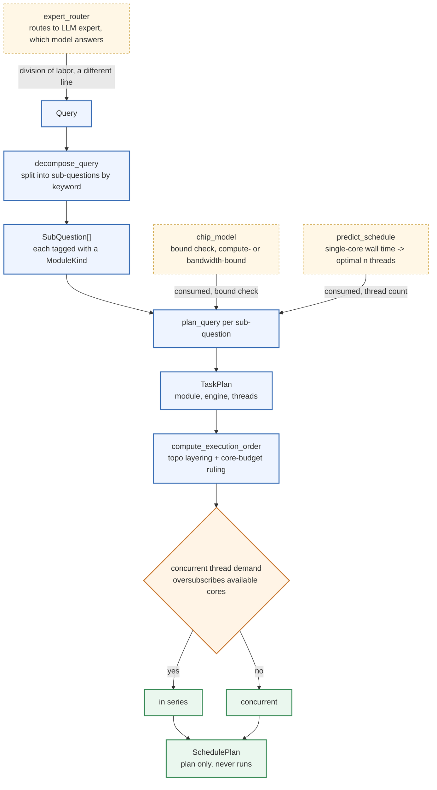

# Kakeya AI Prototype

English | [简体中文](README.md)

A research-oriented Python prototype for geometric modeling, numerical estimation,
and AI-assisted reasoning on three-dimensional Kakeya-type problems.

## Overview

The project turns mathematical ideas into runnable computational experiments, and
provides a platform suited to research, teaching, and algorithm validation. It
combines:

- **Geometric structure modeling**: representing tube-like sets, directions, and
  the geometric relations between them;
- **Numerical estimation and verification**: evaluating volume lower bounds,
  approximate estimates, and experimental results;
- **Heuristic search and reasoning**: exploring candidate paths with a surrogate
  scorer and an LLM scorer, backed by a shared guard so that "an answer was
  produced but never used" never counts as "took effect";
- **Scheduling and resource modeling**: breaking "query → sub-question →
  module/resource → execution order → plan" into a testable scheduling main
  chain, plus a chip budget model (compute- or bandwidth-bound, thread-count
  selection).

This is a research prototype and experimental platform, not a production system.

## Core capabilities

- A research-oriented framework for geometric representation and computation
  (a pure numerical kernel, so conclusions can be re-checked independently)
- Volume estimation pipelines that adapt to several experimental configurations
  (with a C++ accelerated kernel that falls back to NumPy when absent)
- Experimental interfaces for candidate search and reasoning orchestration
  (`.kpt` proof traces with a hash chain)
- A dynamic scheduling main chain and chip budget model (produces plans only,
  never executes computation)
- An inference entry point compatible with a local model runtime (Ollama)

## Repository layout

```text
.
├── src/kakeya_ai/      # Core Python package: the numerical spine (primitives →
│                       #   wolff_axioms → grains → moves → proof_orchestrator →
│                       #   trace_format) plus the AI reasoning layer
│                       #   (ollama_client / expert_router / surrogate_scorer, ...)
├── cpp/                # C++ accelerated kernel (pybind11 + C ABI; falls back
│                       #   to NumPy when absent)
├── nano/               # Scheduling and chip budget model: manifest/ (the
│                       #   architecture manifest, single source of truth),
│                       #   model/ (chip_model), scheduling/ (the main chain),
│                       #   runtime/ (resource rulings)
├── scripts/            # Demo entry point (orchestration/demo_proof_orchestrator.py)
│                       #   and the optional diagram export script
│                       #   (docs_build/render_diagrams.sh)
├── tests/              # pytest suite (slow cases are skipped by default)
└── docs/diagrams/      # Architecture diagrams (scheduling main chain / data
                        #   flow / move selection, Mermaid sources)
```

## Quick start

```bash
python3 -m venv .venv
source .venv/bin/activate
pip install -e .[dev]   # the package itself (incl. the kakeya-kpt command) plus dev deps

# Optional: build the C++ accelerated kernel (the NumPy backend is used when absent)
bash cpp/build_nano.sh
```

Run the tests related to your change (the full suite is slow on a laptop, so
running it per directory is more practical):

```bash
.venv/bin/python -m pytest tests/orchestration/test_trace_format.py -q
.venv/bin/python -m pytest tests/geometry -q
```

AI-related features need a local [Ollama](https://ollama.com)
(`ollama pull qwen3.5:4b`); **the tests run without it** — model-dependent cases
are skipped or stubbed automatically.

## The `.kpt` trace tooling

Proof traces (`.kpt`: hash-chained JSONL whose quantitative conclusions a third
party can re-verify) ship with a command-line interpreter, available as
`kakeya-kpt` once installed:

```bash
kakeya-kpt head trace.kpt --json     # quick open: header metadata only (scale / conclusion / parameters)
kakeya-kpt steps trace.kpt -n 10     # stream step by step (--offset to skip ahead, --json for line-by-line output)
kakeya-kpt show trace.kpt            # render the whole trace as readable text
kakeya-kpt verify trace.kpt          # independent check: hash chain + recomputation (--no-recompute: chain only)
kakeya-kpt json trace.kpt --pretty   # structured dump of the entire file
```

## Architecture

**The scheduling main chain** (sections §7/§8 of
`nano/manifest/architecture_manifest.py`): solid vertical edges are the main
chain; orange dashed boxes are the consumed models and the division-of-labor
boundary.



The other two diagrams are likewise committed as Mermaid sources (GitHub and
editors render them directly):

| Diagram | Source |
| --- | --- |
| The numerical spine and its switchable bypass | [docs/diagrams/dataflow_main_en.mmd](docs/diagrams/dataflow_main_en.mmd) |
| Move selection: three paths plus a shared guard | [docs/diagrams/move_selection_en.mmd](docs/diagrams/move_selection_en.mmd) |

The Chinese versions are the matching `*.mmd` files in the same directory. The
**architecture manifest**
[nano/manifest/architecture_manifest.py](nano/manifest/architecture_manifest.py)
is the **single source of truth** for chips / scheduling / kernels / the expert
pool (including the consumption protocol); `scheduler_flow.mmd` and its English
counterpart are generated from it, so hand edits turn a guard test red.

## Contributing

Contributions are welcome. Please read [CONTRIBUTING.md](CONTRIBUTING.md) first —
this repository has conventions that differ from a typical open-source project
(local resource constraints, minimal diffs, documentation-sync requirements).
See [CODE_OF_CONDUCT.md](CODE_OF_CONDUCT.md) for the code of conduct.

The project's own documents (`CONTRIBUTING.md`, `SECURITY.md`, `LICENSING.md`) are
written in Chinese, and so are code comments and docstrings. English issues and
pull requests are welcome; the maintainers will reply in English.

## Security

**Please do not report security vulnerabilities in a public issue.** Contact
details are in [SECURITY.md](SECURITY.md).

## License

This project is **dual-licensed**: academic / non-commercial use falls under
[AGPL-3.0](LICENSE) (including the section 13 network-interaction clause);
commercial use requires a separate license. See [LICENSING.md](LICENSING.md) for
details.

## Citation

If you use this project in academic work, please cite it as described in
[CITATION.cff](CITATION.cff).
