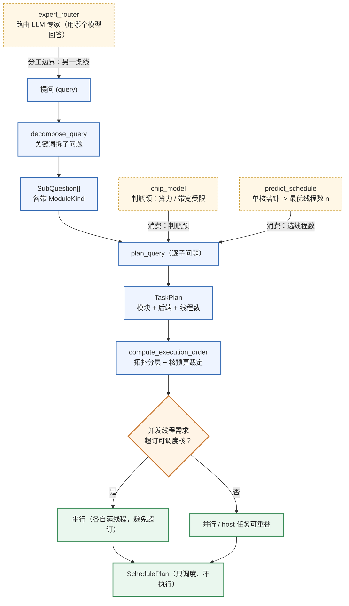

# Kakeya AI Prototype

简体中文 | [English](README.en.md)

一个面向研究与实验的 Python 原型项目，聚焦三维 Kakeya 型问题中的几何建模、
数值估计与 AI 辅助推理。

## 项目简介

该项目旨在把数学思想转化为可运行的计算实验，提供一套适合研究、教学与算法
验证的实验平台。它结合了：

- **几何结构建模**：用于表达管状集合、方向与相关几何关系；
- **数值估计与验证**：用于评估体积下界、近似估计与实验结果；
- **启发式搜索与推理**：用 surrogate 打分器与 LLM 打分器探索候选路径，
  并以共用守卫保证"给了答案但没用"不被算成"生效"；
- **调度与资源建模**：把"提问 → 子问题 → 模块/资源 → 执行顺序 → 计划"
  拆成可测的调度主链，配套芯片预算模型（算力/带宽瓶颈、线程数选择）。

这个项目更偏向"研究原型"和"实验平台"，而不是生产级系统。

## 核心能力

- 研究导向的几何表达与计算框架（纯函数数值内核，结论可独立复核）
- 适用于多种实验配置的体积估计流程（含 C++ 加速内核，缺失时回退 NumPy）
- 面向候选搜索与推理编排的实验接口（`.kpt` 证明轨迹，带哈希链）
- 动态调度主链与芯片预算模型（只产出计划、不执行计算）
- 与本地模型运行环境（Ollama）兼容的推理入口

## 项目结构

```text
.
├── src/kakeya_ai/      # 核心 Python 包：数值主干（primitives → wolff_axioms →
│                       #   grains → moves → proof_orchestrator → trace_format）
│                       #   与 AI 推理层（ollama_client / expert_router / surrogate_scorer 等）
├── cpp/                # C++ 加速内核（pybind11 + C ABI；缺失时回退 NumPy）
├── nano/               # 调度与芯片预算模型：manifest/（架构清单，单一真源）、
│                       #   model/（chip_model）、scheduling/（调度主链）、runtime/（资源裁定）
├── scripts/            # 演示入口（orchestration/demo_proof_orchestrator.py）
│                       #   与可选的架构图导出脚本（docs_build/render_diagrams.sh）
├── tests/              # pytest 测试（slow 用例默认跳过）
└── docs/diagrams/      # 架构图（调度主链 / 数据流 / Move 选择，Mermaid 源）
```

## 快速开始

```bash
python3 -m venv .venv
source .venv/bin/activate
pip install -e .[dev]   # 安装包本体（含 kakeya-kpt 命令）与开发依赖

# 可选：构建 C++ 加速内核（缺失时自动回退 NumPy 后端）
bash cpp/build_nano.sh
```

跑与改动相关的测试（完整套件在本机较慢，按目录分批更实际）：

```bash
.venv/bin/python -m pytest tests/orchestration/test_trace_format.py -q
.venv/bin/python -m pytest tests/geometry -q
```

AI 相关功能需要本地 [Ollama](https://ollama.com)（`ollama pull qwen3.5:4b`）；
**没有 Ollama 也能跑测试**——依赖模型的用例会自动跳过或打桩。

## `.kpt` 轨迹工具

证明轨迹（`.kpt`，带哈希链的 JSONL，定量结论可由第三方独立复核）自带
命令行解释器，安装后可用 `kakeya-kpt`：

```bash
kakeya-kpt head trace.kpt --json     # 快速打开：只读头部元数据（规模/结论/参数）
kakeya-kpt steps trace.kpt -n 10     # 流式逐步读出（支持 --offset 跳步、--json 逐行输出）
kakeya-kpt show trace.kpt            # 完整渲染成可读文本
kakeya-kpt verify trace.kpt          # 独立复核：哈希链 + 重算（--no-recompute 只验链）
kakeya-kpt json trace.kpt --pretty   # 结构化输出整个文件
```

## 架构

**调度主链**（对应 `nano/manifest/architecture_manifest.py` 的 §7/§8）：
竖直实线是主链，橙色虚线框是被消费的模型与分工边界。



其余两张图同样以 Mermaid 源入库（GitHub 与编辑器可直接打开）：

| 图 | 源文件 |
| --- | --- |
| 数值主干与可关闭的旁路 | [docs/diagrams/dataflow_main.mmd](docs/diagrams/dataflow_main.mmd) |
| Move 选择：三条路径 + 共用守卫 | [docs/diagrams/move_selection.mmd](docs/diagrams/move_selection.mmd) |

英文版为同目录的 `*_en.mmd`。**架构清单**
[nano/manifest/architecture_manifest.py](nano/manifest/architecture_manifest.py)
是芯片/调度/内核/专家池的**单一真源**（含消费协议）；`scheduler_flow.mmd`
由它生成，手改会被守门判红。

## 参与贡献

欢迎贡献。请先读 [CONTRIBUTING.md](CONTRIBUTING.md)——本仓库有若干与
"常规开源项目"不同的约定（本机资源约束、改动最小化、文档同步要求）。
行为准则见 [CODE_OF_CONDUCT.md](CODE_OF_CONDUCT.md)。

## 安全问题

**请勿开公开 issue 报告安全漏洞**，联系方式见 [SECURITY.md](SECURITY.md)。

## 许可

本项目采用**双许可**：学术/非商业场景适用
[AGPL-3.0](LICENSE)（含第 13 条网络交互条款）；商业使用需单独授权。
详见 [LICENSING.md](LICENSING.md)。

## 引用

若在学术工作中使用本项目，请按 [CITATION.cff](CITATION.cff) 中的信息引用。
